<div align="center">


# MatFile

**Der Datei-Explorer fürs NAS – im Browser.**

Mehrere Speicherorte, SMB/SFTP/FTP/WebDAV, Tabs, Vorschau, Suche, Benutzer und Rechte.
Ein Container, keine Cloud, keine Fremddienste.

</div>

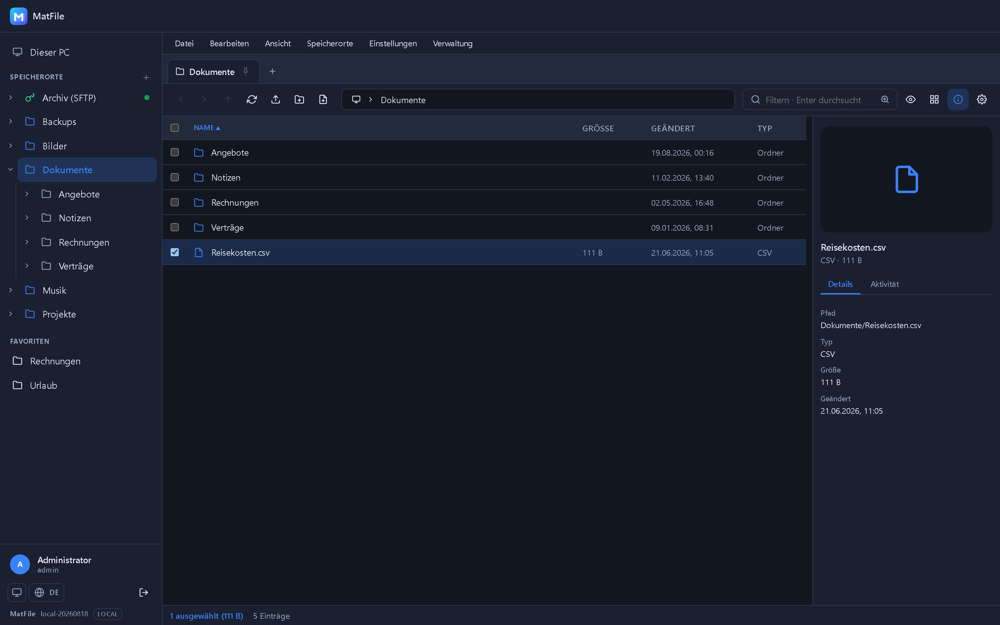

---

## Worum es geht

TrueNAS, Synology & Co. speichern zuverlässig – aber der Weg zu einer einzelnen Datei führt
über Freigaben, Laufwerksbuchstaben oder SSH. MatFile legt einen Datei-Explorer darüber, der
im Browser läuft: lokale Pfade und Netzfreigaben nebeneinander, mit Tabs, Vorschau, Suche
und einer Benutzerverwaltung, die festlegt, wer was sehen und ändern darf.

## Auf einen Blick

**Speicherorte**
- Mehrere frei konfigurierbare **Home-/Root-Pfade** – nur diese sind sichtbar
- Freigaben per **SMB, SFTP, FTP und WebDAV**, ohne Zusatzrechte im Container
  (NFS folgt über einen OS-Mount)
- **SMB auch ohne Freigabe**: Feld leer lassen, dann stehen alle Freigaben des Servers als
  Ordner in der obersten Ebene
- Zugangsdaten liegen **verschlüsselt** in der Datenbank, Verbindungstest vor dem Speichern
- **Erreichbarkeit** je Speicherort direkt in der Seitenleiste: grüner Punkt oder rotes Kreuz

**Bedienung**
- **„Dieser PC"** als Wurzel über allen Speicherorten – mit freiem Platz je Ort
- **Tabs** wie im Windows-Explorer: anheften, verschieben, Mittelklick zum Schließen
- Seitenleiste mit **Ordnerbaum zum Aufklappen** (je Benutzer zuschaltbar) und ziehbarer Breite
- Menüleiste, Rechtsklick-Menü, Mehrfachauswahl, Rubber-Band, Drag & Drop
- **Tastenkürzel** für alles Wichtige – **F1** zeigt die Übersicht
- **Hell und dunkel**, Deutsch und Englisch, auf schmalen Schirmen als Off-Canvas-Layout

**Dateien**
- Upload (auch große Dateien in Blöcken), Download, **ZIP packen und entpacken**
- Kopieren und Verschieben, auch **über Speicherorte hinweg**, mit Fortschritt und Abbruch
- **Vorschau mit echtem Streaming** für Bilder, Video, Audio, PDF und Text
- **Dateien anlegen** und **Texteditor mit Syntaxhervorhebung**
- **Erweiterte Suche als eigener Tab**: rekursiv, auf Wunsch im Dateiinhalt, mit Fundstelle
- **Zugriffsrechte** (rwx) über *Eigenschaften* – lokal, SFTP und FTP

**Benutzer und Betrieb**
- Lokale Benutzerverwaltung mit **Rollensystem** und Rechtematrix je Speicherort
- **Administrationsbereich**: Benutzer, Rollen, Speicherorte, Systemeinstellungen, Protokoll
- Kontosperre und **Rate-Limit** für Anmeldeversuche, erzwungener Kennwortwechsel
- Sessions überleben den Container-Neustart, **Protokoll** über alle Aktionen

## Bilder

### „Dieser PC" – alle Speicherorte mit freiem Platz

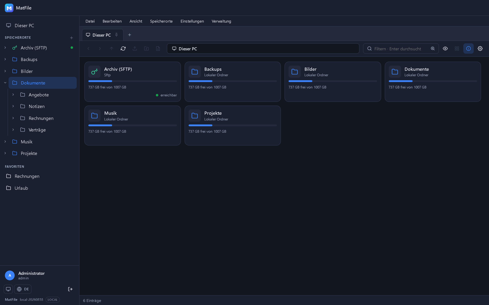

Jeder Speicherort als Kachel mit Typ, Belegung und Zustand. Ein Klick öffnet ihn im selben
Tab, die erste Brotkrume führt zurück – wie der Arbeitsplatz im Windows-Explorer.

### Suche in einem eigenen Tab

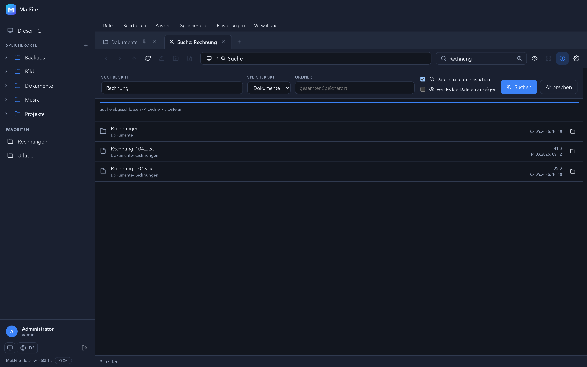

Tippen filtert den Ordner, Enter öffnet die rekursive Suche – auf Wunsch im Dateiinhalt,
mit Fortschritt, Abbruch und Sprung in den Trefferordner.

### Vorschau und Texteditor

| Vorschau | Editor |
|---|---|
| 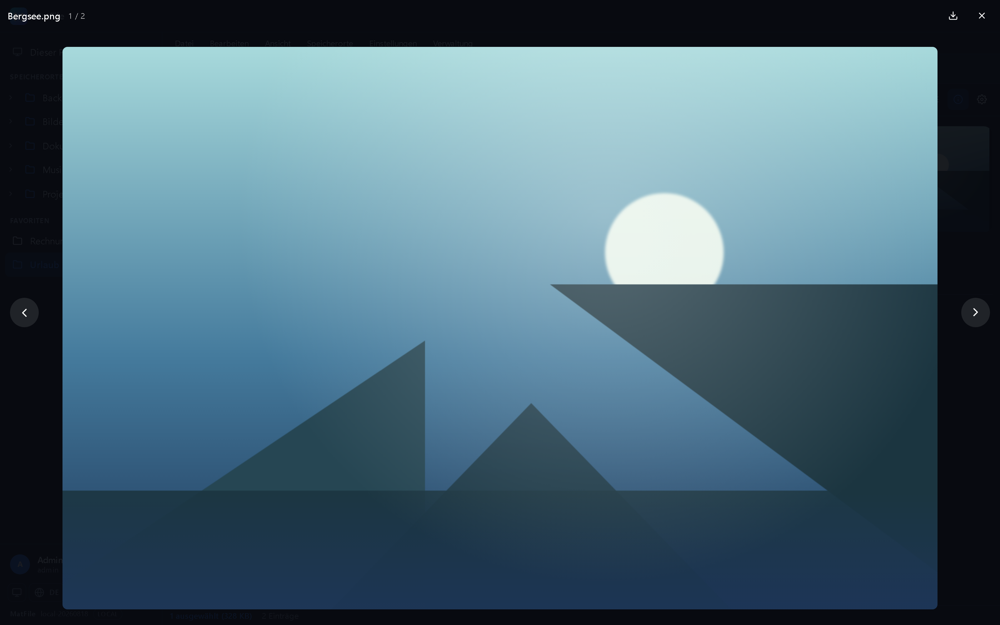 | 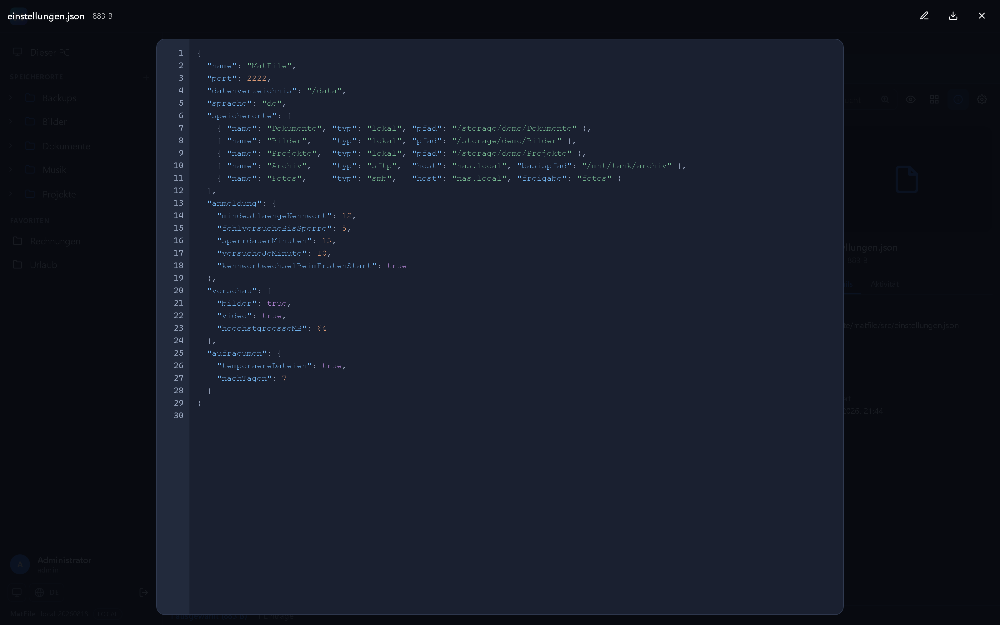 |

Bilder, Video, Audio, PDF und Text werden gestreamt, nicht heruntergeladen. Textdateien
lassen sich direkt bearbeiten und speichern.

### Zugriffsrechte in den Eigenschaften

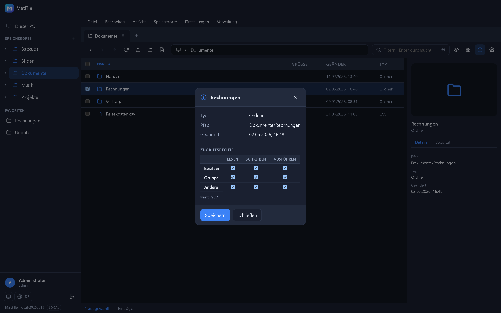

Lesen, Schreiben, Ausführen für Besitzer, Gruppe und Andere – bei lokalen Pfaden, SFTP und
FTP. Speicherorte ohne POSIX-Rechte blenden den Abschnitt aus.

### Administration an einer Stelle

| Benutzer | Speicherorte | Protokoll |
|---|---|---|
| 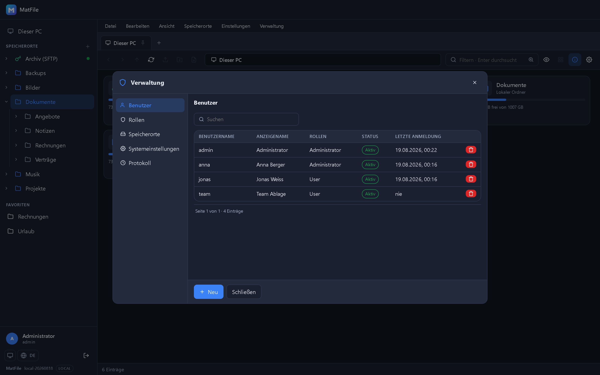 | 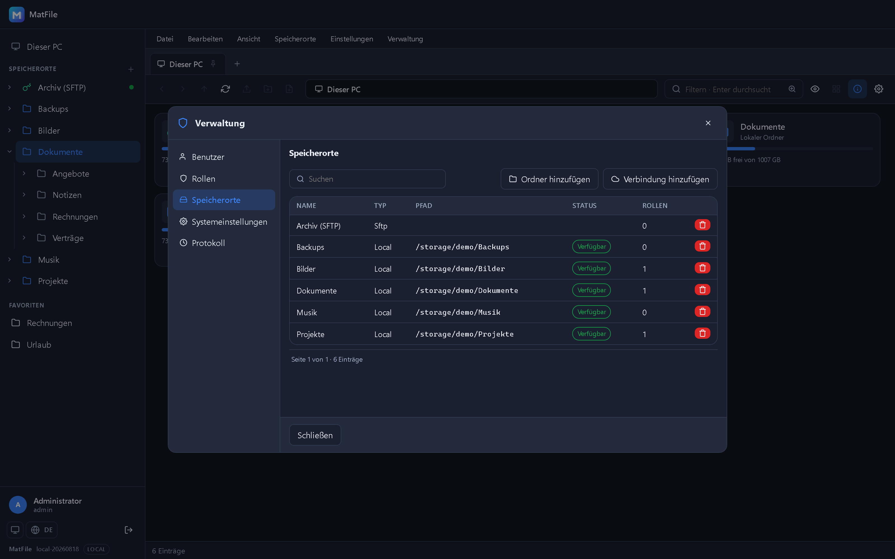 | 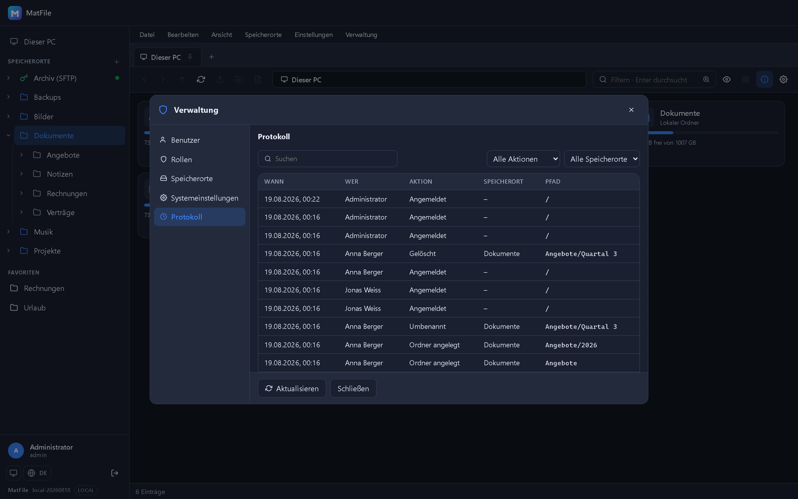 |

Benutzer, Rollen, Speicherorte, Systemeinstellungen und das Protokoll in einem Fenster.
Sichtbar ist nur, wofür das Recht da ist.

### Helles Erscheinungsbild und schmale Schirme

| Hell | Telefon | Seitenleiste |
|---|---|---|
| 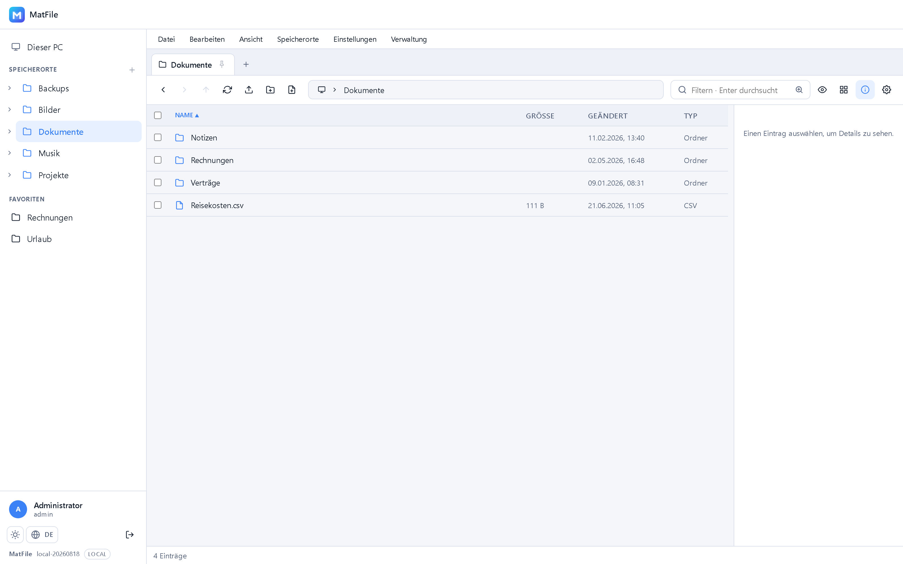 | 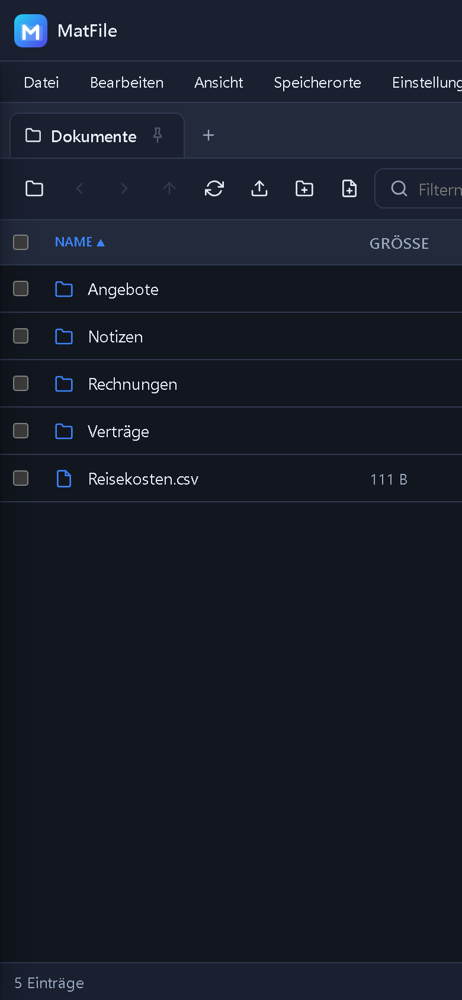 | 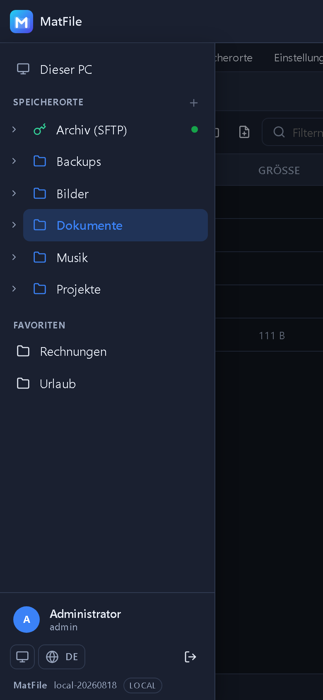 |

## Schnellstart

```bash
docker compose up -d --build
```

Danach erreichbar unter **http://localhost:2222** (Health-Check: `/healthz`).
Beim ersten Start wird das Konto **`admin` / `admin`** angelegt.

NAS-Volumes werden per Bind-Mount in den Container gelegt und danach im UI als Speicherort
angelegt:

```yaml
services:
  matfile:
    volumes:
      - matfile-data:/data
      - /mnt/tank:/storage/tank      # <- eigene Freigabe
```

Für die Entwicklung gibt es einen eigenen Stack:

```bash
docker compose -f docker-compose.dev.yml up -d --build
```

### Wichtige Einstellungen

| Variable | Standard | Bedeutung |
|---|---|---|
| `ASPNETCORE_HTTP_PORTS` | `2222` | Port im Container |
| `MATFILE_DATA` | `/data` | Datenverzeichnis (SQLite, Config, Keys, Thumbnails) |
| `PUID` / `PGID` | – | Optional: als unprivilegierter Benutzer laufen |
| `MATFILE_ADMIN_PASSWORD` | `admin` | Startkennwort für `admin` beim ersten Start |
| `TZ` | `Europe/Berlin` | Zeitzone |

### Nach der ersten Anmeldung

*Verwaltung* in der Menüleiste öffnet den Administrationsbereich mit **Benutzern, Rollen,
Speicherorten, Systemeinstellungen und Protokoll**. Für den produktiven Betrieb dort
**Kennwortwechsel beim ersten Start** einschalten – dann verlangt MatFile bei der ersten
Anmeldung ein eigenes Kennwort.

Die **Systemeinstellungen** gelten für alle: Mindestlänge für Kennwörter, Sitzungsdauer,
Fehlversuche bis zur Sperre, Sperrdauer, Anmeldeversuche je Minute, Höchstgröße beim
Hochladen (0 = keine Grenze), HTTPS-Cookie und der Kennwortwechsel beim ersten Start. Sie
landen in `/data/config/matfile.json`; Mindestlänge und Kontosperre wirken sofort, Cookie,
Sitzungsdauer und Rate-Limit nach einem Neustart des Containers.

Die Oberfläche startet auf Englisch; über den Weltkugel-Knopf unten links (oder
*Einstellungen → Sprache…*) lässt sich Deutsch wählen – die Auswahl bleibt am Benutzerkonto.

### Das Volume `/data`

```
/data
├─ matfile.db      SQLite-Datenbank
├─ config/         JSON-Konfiguration
├─ keys/           DataProtection-Keys (Sessions überleben Neustarts)
├─ thumbs/         Thumbnail-Cache
└─ temp/           Chunk-Uploads, ZIP-Staging
```

Für OS-Level-Mounts (NFS, alternativ SMB) braucht der Container `cap_add: [SYS_ADMIN]`; die
In-Process-Provider für SMB, SFTP, FTP und WebDAV kommen ohne Zusatzrechte aus.

## Stand

| Meilenstein | Inhalt | Status |
|---|---|---|
| M0 | Grundgerüst, Docker, CI, Versionierung | ✅ |
| M1 | Datenbank, Anmeldung, Rollen, Sessions, Mehrsprachigkeit | ✅ |
| M2 | Designsystem, Controls, Verwaltung (Benutzer, Rollen, Speicherorte) | ✅ |
| M3 | Storage-Abstraktion, PathGuard, Root-Verwaltung, Listing-API | ✅ |
| M4 | Explorer: Sidebar, Tabs, Navigation, Mehrfachauswahl, Favoriten, Download | ✅ |
| M5 | Dateioperationen, Upload, ZIP/Unzip, Job-Queue mit Fortschritt | ✅ |
| M6 | Vorschau und Streaming, Detailbereich mit Protokoll | ✅ |
| M7 | Remote-Verbindungen: **SMB, SFTP, FTP, WebDAV** inkl. Verbindungstest | ✅ |
| M7c | Rekursive Suche mit Inhaltssuche, Verwaltung in Dialogen | ✅ |
| M7d | Systemeinstellungen, Zugriffsrechte über *Eigenschaften*, eigener Teststack | ✅ |
| M7e | Administrationsbereich, „Dieser PC" mit freiem Platz, Ordnerbaum, Verbindungspool | ✅ |
| M7b | NFS über OS-Mount, Mounts nur für die Sitzung | offen |
| M8–M9 | Thumbnails, Icon-Feinschliff, Härtung | offen |

Der vollständige Umsetzungsplan liegt in [docs/PLAN.md](docs/PLAN.md).

## Entwicklung

Gebaut und getestet wird über den Container:

```bash
docker compose -f docker-compose.dev.yml up -d --build
docker compose -f docker-compose.dev.yml logs -f
```

Lokal ohne Docker:

```bash
dotnet run --project src/MatFile.Web
```

Unit-Tests brauchen keinen Container:

```powershell
dotnet test MatFile.slnx
```

Die Integrationstests laufen auf einem **eigenen Stack** (Port 2223, eigenes Volume), damit
der Entwicklungsstack mit seinen Speicherorten stehen bleibt:

```powershell
.\tests\run-all.ps1
```

Dazu kommen Browser-Prüfungen über headless Edge (ohne npm) – Einzelheiten in
[`tests/README.md`](tests/README.md).

## Technik

- **ASP.NET Core 10** (Razor Pages + Minimal-API), **EF Core** mit SQLite
- Oberfläche in **reinem JavaScript** (ES-Module), kein Framework, kein Build-Schritt
- Speicher-Provider hinter einer Schnittstelle: `Local`, `Smb` (SMBLibrary), `Sftp` (SSH.NET),
  `Ftp` (FluentFTP), `WebDav`
- Verbindungen zu Gegenstellen laufen über einen **Pool** – wiederverwendet statt je Abfrage neu
- Zugangsdaten über **DataProtection** verschlüsselt, Pfade über `PathGuard` gegen Ausbrüche gesichert

## Branches & Versionierung

| Branch | Zweck | Version |
|---|---|---|
| `main` | Release | `<major>.<minor>.<buildnummer>-<yyyyMMdd>` |
| `dev` | Development | `nightly-<buildnummer>-<yyyyMMdd>` |
| lokal | – | `local-<yyyyMMdd>` |

`Major`/`Minor` stehen in [`version.props`](version.props), die Buildnummer liefert die
GitHub Action (`github.run_number`). Images landen in der GitHub Container Registry.
