<div align="center">


# MatFile

**A file explorer for your NAS – in the browser.**

Several storage locations, SMB/SFTP/FTP/WebDAV, tabs, preview, search, users and permissions.
One container, no cloud, no third-party services.

</div>

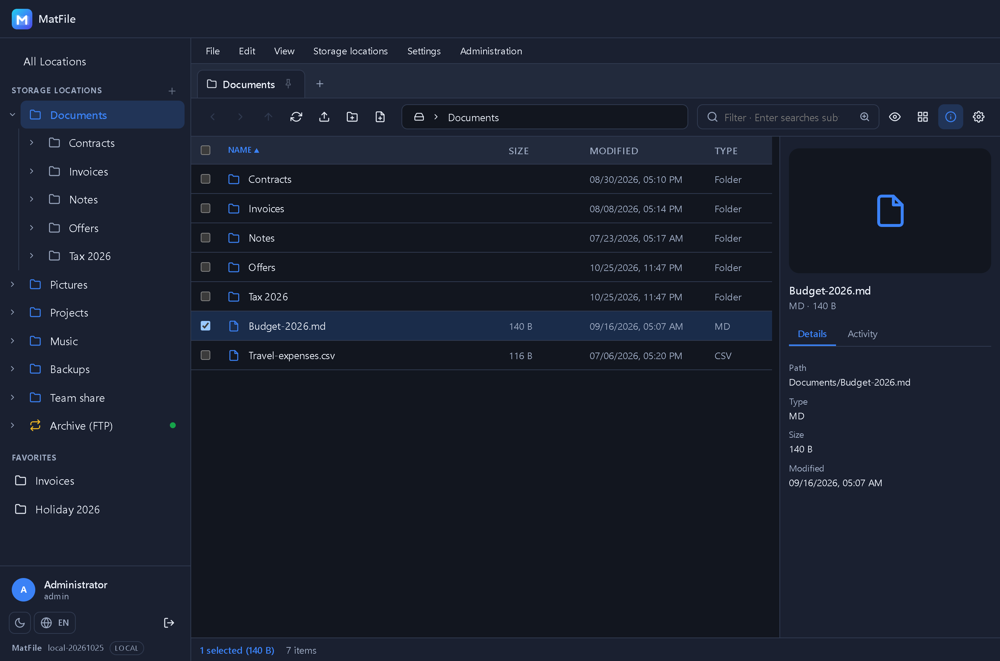

---

## What this is about

TrueNAS, Synology and the like store your data reliably – but getting to a single file means
going through shares, drive letters or SSH. MatFile puts a file explorer on top of them that
runs in the browser: local paths and network shares side by side, with tabs, preview, search
and a user management that decides who may see and change what.

## At a glance

**Storage locations**
- Several freely configurable **home/root paths** – only these are visible
- Shares via **SMB, SFTP, FTP and WebDAV**, without extra privileges in the container
  (NFS will follow through an OS mount)
- **SMB without a share as well**: leave the field empty and every share of the server shows
  up as a folder on the top level
- Credentials are stored **encrypted**, with a connection test before saving
- **Reachability** per location right in the sidebar: a green dot or a red cross

**Using it**
- **"All Locations"** as the root above every storage location – including free space
- **Tabs** like in Windows Explorer: pin, reorder, middle-click to close
- Sidebar with an **expandable folder tree** (per user, off by default) and a draggable width
- Menu bar, right-click menu, multi-select, rubber-band selection, drag & drop
- **Keyboard shortcuts** for everything that matters – **F1** shows the list
- **Light and dark**, English and German, off-canvas layout on narrow screens

**Files**
- Upload (large files in chunks), download, **zip and unzip**
- Copy and move, **across storage locations** too, with progress and cancel
- **Preview with real streaming** for images, video, audio, PDF and text
- **Create files** and a **text editor with syntax highlighting**
- **Advanced search in its own tab**: recursive, optionally inside file contents, with the
  matching line
- **Access rights** (rwx) through *Properties* – local, SFTP and FTP

**Users and operations**
- Local user management with **roles** and a permission matrix per storage location
- **Administration area**: users, roles, storage locations, system settings, activity log
- Account lockout and a **rate limit** on sign-in attempts, forced password change
- Sessions survive a container restart, **activity log** across all actions

## Screenshots

### "All Locations" – every storage location with free space

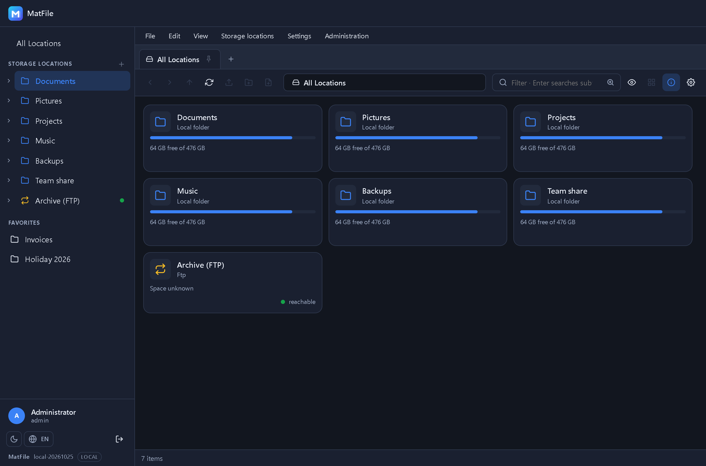

Every location as a card with type, usage and state. One click opens it in the same tab, the
first breadcrumb leads back – the way "This PC" works in Windows Explorer.

### Search in its own tab

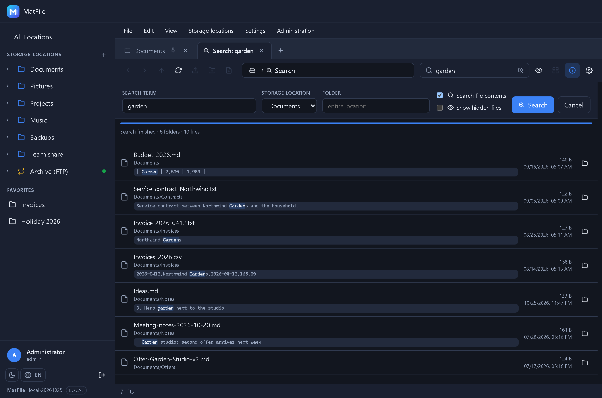

Typing filters the current folder, Enter opens the recursive search – optionally inside file
contents, with progress, cancel and a jump into the folder of a hit.

### Preview and text editor

| Preview | Editor |
|---|---|
|  | 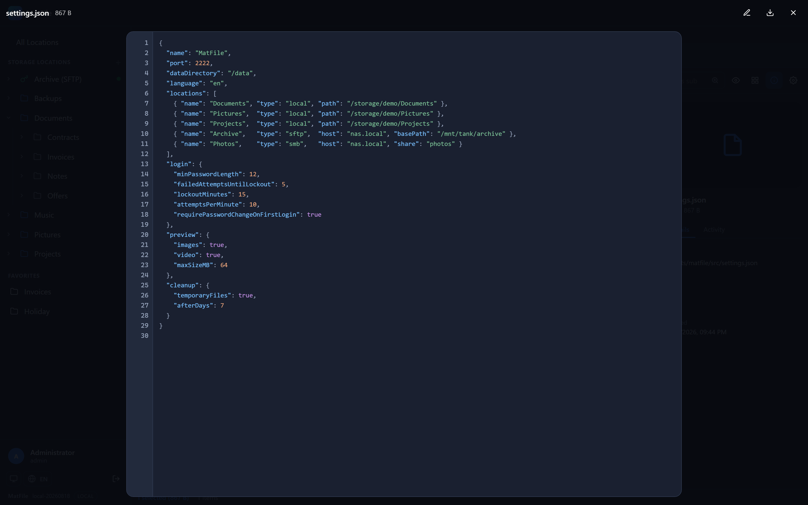 |

Images, video, audio, PDF and text are streamed, not downloaded first. Text files can be
edited and saved right away.

### Access rights in the properties sheet

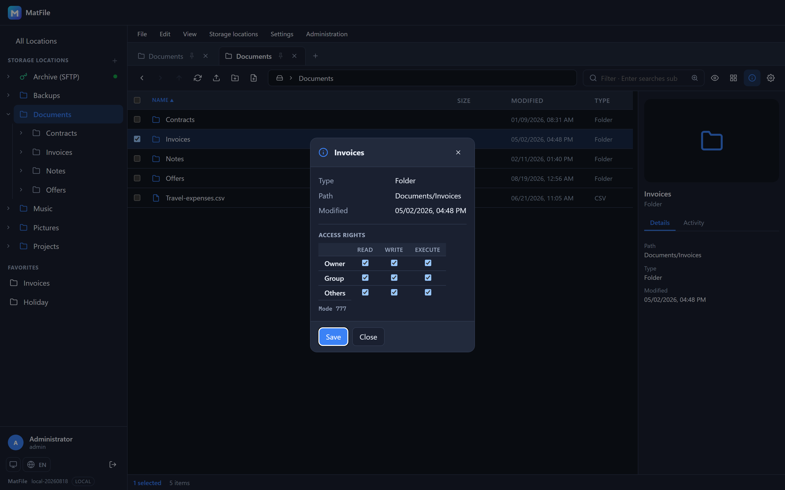

Read, write and execute for owner, group and others – on local paths, SFTP and FTP. Storage
types without POSIX permissions simply hide the section.

### Administration in one place

| Users | Storage locations | Activity log |
|---|---|---|
| 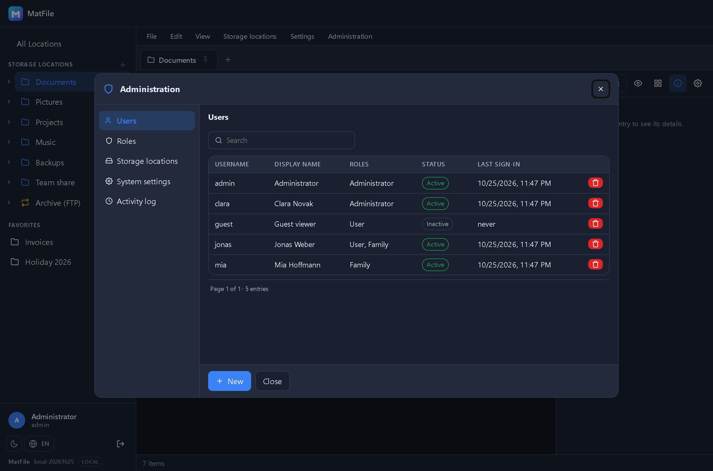 | 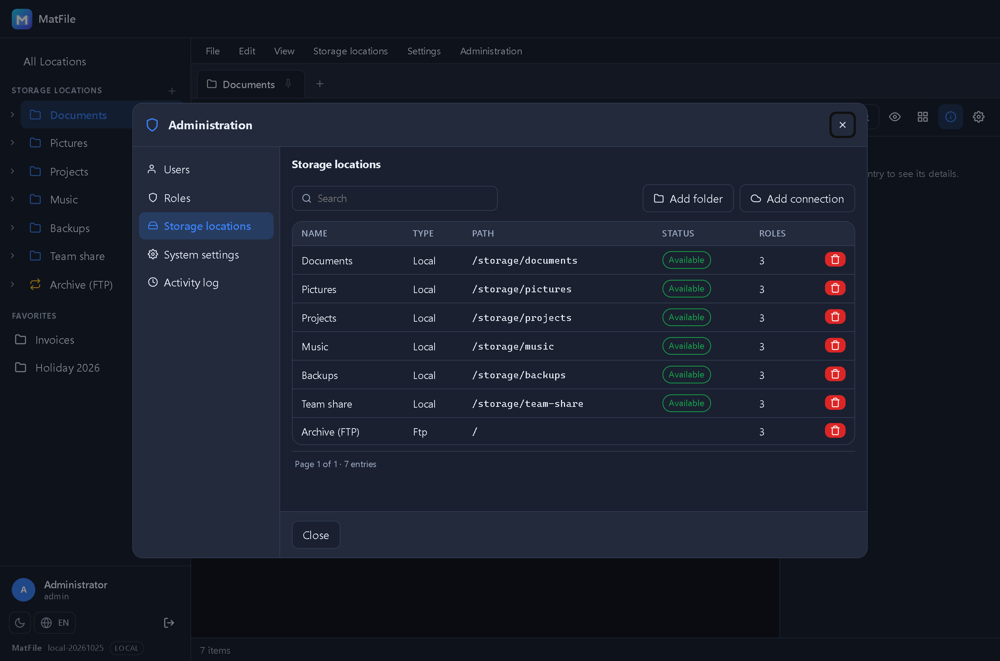 | 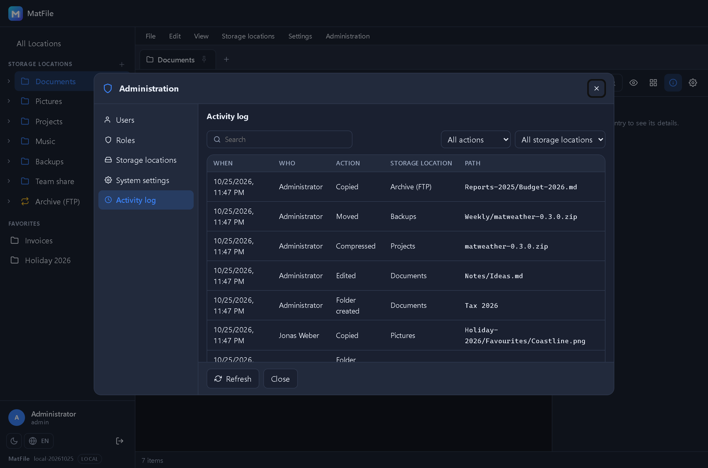 |

Users, roles, storage locations, system settings and the activity log in a single window.
Only the sections you hold a permission for are shown.

### Light theme and narrow screens

| Light | Phone | Sidebar |
|---|---|---|
| 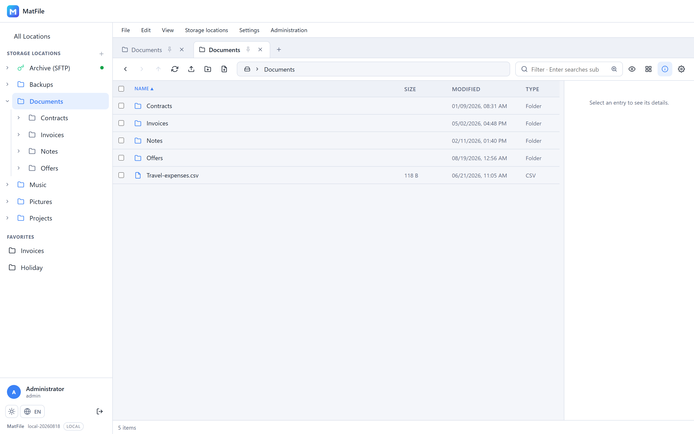 | 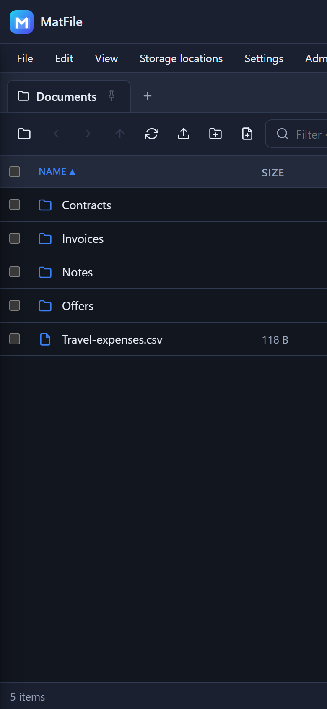 | 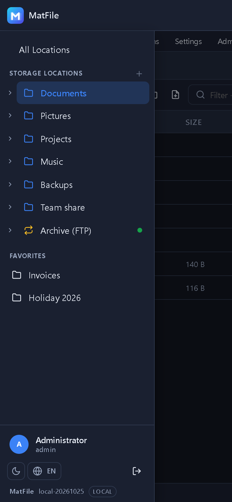 |

## Quick start

Ready-made images are published to the GitHub Container Registry:

| Tag | Built from | Use it for |
|---|---|---|
| `ghcr.io/real-ttx/matfile:latest` | `main` | releases |
| `ghcr.io/real-ttx/matfile:nightly` | `dev` | the newest features |

### 1. Just run it

Copy this into `docker-compose.yml` and start it – nothing else needed:

```yaml
services:
  matfile:
    image: ghcr.io/real-ttx/matfile:latest
    container_name: matfile
    restart: unless-stopped
    ports:
      - "2222:2222"
    volumes:
      - matfile-data:/data

volumes:
  matfile-data:
```

```bash
docker compose up -d
```

Open **http://localhost:2222** and sign in with **`admin` / `admin`**
(health check: `/api/health`; the older `/healthz` still answers). The `matfile-data` volume keeps the database, the
configuration and the session keys, so an update is just `docker compose pull &&
docker compose up -d`.

Without Compose:

```bash
docker run -d --name matfile -p 2222:2222 -v matfile-data:/data \
  ghcr.io/real-ttx/matfile:latest
```

At this point MatFile has no storage location yet – the sidebar says so and offers to add one.
Which brings us to the interesting case.

### 2. With the shares of your NAS

MatFile only ever shows what you hand to the container. Every share is bind-mounted below
`/storage` and then added once in the UI. This example is a Synology (shares live under
`/volume1`):

```yaml
services:
  matfile:
    image: ghcr.io/real-ttx/matfile:latest
    container_name: matfile
    restart: unless-stopped
    ports:
      - "2222:2222"
    environment:
      TZ: Europe/Berlin
      # Own the files as your NAS user instead of root: run "id <user>" over SSH
      PUID: "1026"
      PGID: "100"
    volumes:
      # MatFile's own data - keep this one
      - matfile-data:/data
      # Your shares. Left of the colon is the NAS, right of it what MatFile sees.
      - /volume1/documents:/storage/documents
      - /volume1/photo:/storage/photo
      - /volume1/music:/storage/music:ro     # ":ro" = visible, but read-only

volumes:
  matfile-data:
```

Then in the UI: *Administration → Storage locations → Add folder*, and enter the path
**inside the container** – so `/storage/documents`, not `/volume1/documents`. Repeat per
share, give each one a name, and assign the roles that may see it.

Other systems keep their shares elsewhere; only the left side of the colon changes:

| System | Shares are usually under | Example line |
|---|---|---|
| Synology | `/volume1` | `- /volume1/photo:/storage/photo` |
| TrueNAS SCALE | `/mnt/<pool>` | `- /mnt/tank/media:/storage/media` |
| Unraid | `/mnt/user` | `- /mnt/user/documents:/storage/documents` |
| QNAP | `/share` | `- /share/Public:/storage/public` |
| plain Linux | anywhere | `- /srv/files:/storage/files` |

Worth knowing:

- **A share that is not mounted stays invisible.** That is the point – MatFile can only reach
  what the container can reach.
- **Permissions are the NAS's.** With `PUID`/`PGID` MatFile acts as that user; without them
  it runs as root inside the container. If a folder shows up empty or read-only, that is the
  file system talking, not MatFile.
- **A `:ro` mount stays browsable.** Listing, preview and download work; anything that would
  write answers with "This storage location is read-only" instead of a server error.

Remote shares (SMB, SFTP, FTP, WebDAV) need no mount at all: they are added in the UI under
*Administration → Storage locations → Add connection*, with a connection test before saving.

### 3. From source

```bash
docker compose up -d --build                              # release build
docker compose -f docker-compose.dev.yml up -d --build    # development stack
```

### Settings that matter

| Variable | Default | Meaning |
|---|---|---|
| `ASPNETCORE_HTTP_PORTS` | `2222` | Port inside the container |
| `MATFILE_DATA` | `/data` | Data directory (SQLite, config, keys, thumbnails) |
| `PUID` / `PGID` | – | Optional: run as an unprivileged user |
| `MATFILE_ADMIN_PASSWORD` | `admin` | Initial password for `admin` on first start |
| `TZ` | `Europe/Berlin` | Time zone |
| `MAT_API_KEY` | – | Optional: the key for the platform API (`X-Api-Key` on `/api/state`, `/api/configure`, `/api/actions`). Without it only a token of MatIdentity is accepted there. Mattiverse sets it |
| `MATIDENTITY_AUTHORITY` | – | Optional: the address of MatIdentity (`https://id.example.com`). Set = sign-in through MatIdentity |
| `MATIDENTITY_CLIENT_ID` | `matfile` | The client of MatFile in MatIdentity |
| `MATIDENTITY_CLIENT_SECRET` | – | Its secret |
| `MATIDENTITY_INTERNAL_URL` | – | Optional: where MatFile reaches MatIdentity from inside Docker (`http://matidentity:2300`); the browser keeps using the authority |

### After the first sign-in

*Administration* in the menu bar opens the admin area with **users, roles, storage locations,
system settings and the activity log**. For production, turn on **password change on first
sign-in** there – MatFile will then ask for a password of your own the first time.

The **system settings** apply to everyone: minimum password length, session lifetime, failed
attempts until lockout, lockout duration, sign-in attempts per minute, maximum upload size
(0 = no limit), the HTTPS cookie and the password change on first sign-in. They end up in
`/data/config/matfile.json`; minimum length and lockout take effect immediately, cookie,
session lifetime and rate limit after a container restart.

The interface starts in English; the globe button at the bottom left (or *Settings →
Language…*) switches to German – the choice stays with the user account.

### The `/data` volume

```
/data
├─ matfile.db      SQLite database
├─ config/         JSON configuration
├─ keys/           DataProtection keys (sessions survive restarts)
├─ thumbs/         thumbnail cache
└─ temp/           chunked uploads, zip staging
```

OS-level mounts (NFS, or SMB as an alternative) need `cap_add: [SYS_ADMIN]`; the in-process
providers for SMB, SFTP, FTP and WebDAV work without extra privileges.

## Mat platform: API and sign-in through MatIdentity

MatFile follows the platform contract of the Mat apps (MatDesign `docs/PLATFORM.md`, through the shared package
MatPlatform in `src/MatFile.Web/MatPlatform/`, a copy that is never edited here), so Mattiverse can show it, watch it,
set it up and act on it. MatFile's own API under `/api/fs`, `/api/jobs`, `/api/settings` ... stays as it is; the
contract lives next to it.

| Endpoint | Access | What it is |
|---|---|---|
| `GET /api` | anonymous | the description: pages *Overview* and *Settings*, tiles, fields, actions, roles (German or English by `Accept-Language`) |
| `GET /api/health` | anonymous | `ok` / `degraded` / `down` with the checks `database`, `data` (the data directory is writable) and, after a check of the storage locations, `storage`; 503 only for `down`. The Docker `HEALTHCHECK` calls it |
| `GET /api/state[/{key}]` | key or token | the tiles: storage locations, not reachable, storage used / total / free (each file system once; local, SFTP and SMB report it), running jobs, failed jobs in 24 h, active users, last activity |
| `GET` / `PUT /api/configure` | key or token | six settings of the system dialog: session lifetime, failed attempts until lockout, lockout duration, minimum password length, HTTPS-only cookie, maximum upload size. Same file, same limits; each change goes to the activity log with who made it |
| `POST /api/actions/{id}` | key or token | `checkStorage` (checks every storage location now), `cancelJobs` (cancels every waiting and running job, 409 when there is none) |

The links of the description are `/` (open MatFile), `/?admin=activity` (the activity log) and `/?admin=system` (all
settings): `?admin=<users|roles|roots|system|activity>` opens the administration in that section. The roles are `admin`
(the system role *Administrator*) and `user` (the system role *User*).

**Sign-in through MatIdentity** is on when `MATIDENTITY_AUTHORITY` is set; without it nothing changes. Then `/Login`
goes straight to MatIdentity (authorization code with PKCE) and comes back signed in; the local form stays at
`/Login?local=1` (the way in when MatIdentity is down). Register MatFile in MatIdentity with the redirect address
`https://<matfile>/signin-oidc` and the signed-out address `https://<matfile>/signout-callback-oidc`.

- The person is found by the claim `sub`. Without a match, a new account is created (user name, display name and
  e-mail from the claims, no local password).
- **An existing account is never linked by its address alone.** When exactly one active, not yet linked account with a
  password has the same e-mail address (or, without one, the same user name), MatFile shows `/Login?local=1&link=1`:
  sign in once with that account's password to connect it, or cancel. Only that account gets linked (written to the
  activity log as *Linked with MatIdentity*); another account signing in links nothing. Several matches, a disabled
  account or a match linked to another person are refused.
- The claim `role` (`admin` or `user`) is followed at every sign-in; the last active administrator keeps the role.
  Without the claim MatFile keeps managing the roles itself (a new account gets *User*).
- Signing out ends the session at MatIdentity too.

## Status

| Milestone | Content | Status |
|---|---|---|
| M0 | Skeleton, Docker, CI, versioning | ✅ |
| M1 | Database, sign-in, roles, sessions, localisation | ✅ |
| M2 | Design system, controls, management (users, roles, storage locations) | ✅ |
| M3 | Storage abstraction, PathGuard, root management, listing API | ✅ |
| M4 | Explorer: sidebar, tabs, navigation, multi-select, favourites, download | ✅ |
| M5 | File operations, upload, zip/unzip, job queue with progress | ✅ |
| M6 | Preview and streaming, details pane with activity | ✅ |
| M7 | Remote connections: **SMB, SFTP, FTP, WebDAV** incl. connection test | ✅ |
| M7c | Recursive search with content search, management in dialogs | ✅ |
| M7d | System settings, access rights in *Properties*, separate test stack | ✅ |
| M7e | Administration area, **"All Locations"** with free space, folder tree, connection pool | ✅ |
| M7b | NFS through an OS mount, mounts for the session only | open |
| M8–M9 | Thumbnails, icon polish, hardening | open |

The full implementation plan lives in [docs/PLAN.md](docs/PLAN.md) (German).

## Development

Building and testing happens through the container:

```bash
docker compose -f docker-compose.dev.yml up -d --build
docker compose -f docker-compose.dev.yml logs -f
```

Locally without Docker:

```bash
dotnet run --project src/MatFile.Web
```

The unit tests need no container:

```powershell
dotnet test MatFile.slnx
```

The integration tests run against a **separate stack** (port 2223, its own volume) so the
development stack keeps its storage locations:

```powershell
.\tests\run-all.ps1
```

On top of that there are browser checks driving headless Edge (no npm involved) – details in
[`tests/README.md`](tests/README.md) (German).

## How it is built

- **ASP.NET Core 10** (Razor Pages + minimal API), **EF Core** with SQLite
- The interface is **plain JavaScript** (ES modules) – no framework, no build step
- Storage providers behind one interface: `Local`, `Smb` (SMBLibrary), `Sftp` (SSH.NET),
  `Ftp` (FluentFTP), `WebDav`
- Connections to remote servers go through a **pool** – reused instead of dialled per request
- Credentials encrypted via **DataProtection**, paths guarded against escapes by `PathGuard`

Source comments, the plan and the test documentation are written in German.

## Branches & versioning

| Branch | Purpose | Version |
|---|---|---|
| `main` | Release | `<major>.<minor>.<build>-<yyyyMMdd>` |
| `dev` | Development | `nightly-<build>-<yyyyMMdd>` |
| local | – | `local-<yyyyMMdd>` |

`Major`/`Minor` live in [`version.props`](version.props), the build number comes from the
GitHub action (`github.run_number`). Images are published to the GitHub Container Registry.
